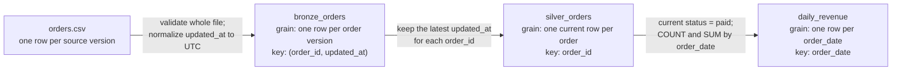

# Lab 01: Reliable order data

## Goal

Build a local batch pipeline that can be rerun safely. The CSV is a synthetic change log: each `(order_id, updated_at)` pair identifies one source version. Money is stored as integer cents to avoid floating-point rounding. `updated_at` must include a timezone and is normalized to UTC.

Run the commands in the root README. Inspect the database with any SQLite viewer or Python's `sqlite3` module. Predict the final paid revenue before running `report`.

## How data moves through the pipeline

Lab 01 is a small teaching pipeline, not a production warehouse design. It
uses three layers that are often called bronze, silver, and gold:

- **bronze** keeps every valid source version, with `updated_at` normalized to UTC
- **silver** keeps one current row per business entity
- **gold** keeps a small summary that a report reads



The same flow as plain text, for viewers that do not render Mermaid:

```text
orders.csv
   |  validate every row first, normalize updated_at to UTC
   v
bronze_orders   one row per (order_id, updated_at)   key: (order_id, updated_at)
   |  for each order_id, keep only the row with the latest updated_at
   v
silver_orders   one current row per order            key: order_id
   |  keep rows whose current status is paid, group by order_date
   v
daily_revenue   one row per order_date               key: order_date
```

| Table | Grain (one row per) | Primary key | Built from |
|---|---|---|---|
| `bronze_orders` | order version | `(order_id, updated_at)` | Every validated CSV row, with `updated_at` stored in UTC. A rerun of the same version is skipped; the same key with different values is rejected. |
| `silver_orders` | order | `order_id` | Rebuilt each run from bronze: the version with the latest `updated_at` for each `order_id`. |
| `daily_revenue` | order date | `order_date` | Rebuilt each run from silver: counts and sums only orders whose **current** status is `paid`. |

**Why bronze can hold several versions of one order but silver cannot:**
bronze's key is the pair `(order_id, updated_at)`, so a later update to the
same order has a different key and is stored alongside the earlier one. That
keeps the history. Silver's key is `order_id` alone, so there is room for only
one row per order, and the pipeline fills it with the latest version.

The sample file shows this. `o-101` arrives twice: `pending` at
`2026-01-02T11:00:00+00:00`, then `paid` at `2026-01-03T12:00:00+00:00`.
Bronze stores both rows (4 versions in total), silver keeps only the `paid`
row (3 current orders), and `daily_revenue` counts `o-101` as paid on its
`order_date`, 2026-01-02 (2 revenue days). Because gold reads the current
status from silver, a later `refunded` or `cancelled` version would remove
that order from the report on the next run.

## Exercises

1. Run the same file twice. Why are the counts and revenue unchanged?
2. Add a later `refunded` version for `o-100`. Predict what happens to the report.
3. Change a version's amount without changing its key. Why does the pipeline reject it?
4. Add an invalid row after a valid row. Verify that a failed run does not partially ingest the file.
5. Add a test for a timezone offset and a new test for a refund arriving late.

### Late-arriving update and backfill

This exercise simulates receiving new source data after an earlier batch has
already been processed. It uses two committed synthetic CSV fixtures and a
throwaway SQLite database; no clock, cloud service, or third-party package is
involved. Run these commands from the repository root:

```bash
python3 -m launchpad.pipeline run --input labs/01-orders/late-arriving-initial.csv --db /tmp/launchpad-late-arrival.db
python3 -m launchpad.pipeline report --db /tmp/launchpad-late-arrival.db
python3 -m launchpad.pipeline run --input labs/01-orders/late-arriving-update.csv --db /tmp/launchpad-late-arrival.db
python3 -m launchpad.pipeline report --db /tmp/launchpad-late-arrival.db
python3 -m launchpad.pipeline run --input labs/01-orders/late-arriving-update.csv --db /tmp/launchpad-late-arrival.db
python3 -m launchpad.pipeline report --db /tmp/launchpad-late-arrival.db
```

Before running them, predict which existing order changes, which new order is
added, and whether the report changes the original event date. The first run
reports 2 input rows, 2 bronze versions, 2 current orders, and 2 revenue days.
Its revenue is 4200 cents on January 5 and 1800 cents on January 6.

The late batch contains a refund for `late-200` with a later `updated_at`,
even though its `order_date` remains January 5, plus a previously unseen paid
order for that same January 5 business date. After the second run, the expected
counts are 2 input rows, 4 bronze versions, 3 current orders, and 2 revenue
days. The report becomes 2500 cents on January 5 and 1800 cents on January 6:
the refund removes the old 4200-cent contribution, the newly arrived order
adds 2500 cents, and the January 6 result is unchanged. The third run repeats
the same late batch; counts and report must remain exactly the same.

Inspect history and current state with:

```bash
python3 -c "import sqlite3; c = sqlite3.connect('/tmp/launchpad-late-arrival.db'); print('bronze:', c.execute('SELECT order_id, order_date, status, updated_at FROM bronze_orders ORDER BY order_id, updated_at').fetchall()); print('silver:', c.execute('SELECT order_id, order_date, status, updated_at FROM silver_orders ORDER BY order_id').fetchall()); c.close()"
```

Bronze should contain four versions; silver should contain three orders, with
`late-200` now refunded. The pipeline rebuilds the small gold summary from
current silver state on every run, so this example demonstrates a logical
backfill without a date-partitioned warehouse. Here, “late” means the update
arrives in a later batch than the first version; the fixtures use explicit
timestamps so the exercise is deterministic. The pipeline orders versions by
`updated_at`, not by file arrival order. A real source needs a trustworthy
version-ordering field and a defined policy for equal timestamps.

### Schema evolution: add an optional source field

The pipeline accepts one optional additive field, `sales_channel`, while
remaining compatible with the original six-column CSV. Missing or whitespace
only values are normalized to `unknown`; any other unrecognized extra column
is rejected. Existing SQLite databases are migrated by adding the field with
the same default.

1. Copy `labs/01-orders/orders.csv` to `orders-with-channel.csv` and add a
   `sales_channel` column with values such as `web` and `store`.
2. Run the pipeline with both the original six-column file and the expanded
   file, each against its own fresh database. Both should succeed.
3. Inspect `bronze_orders` and `silver_orders`: the channel should survive
   both transformations. Try a blank channel and confirm it becomes
   `unknown`; try an unrelated extra column and confirm validation rejects it.
4. Change the channel without changing the order's `(order_id, updated_at)`
   key and replay it. The pipeline should reject this as a conflicting source
   version, just as it does for a changed amount.
5. Run each input twice against its database. Counts and revenue should be
   stable, and the second run should not duplicate history.

Discussion: an additive defaulted field is compatible with old CSV producers
here because the pipeline assigns a stable value to missing data. In a real
ingestion system, coordinate source contracts with downstream consumers and
preserve historical values needed for replay. The database migration gives
existing rows the explicit `unknown` value rather than guessing their channel.

### Cross-midnight UTC exercise

Prerequisites: Python 3.11+, the repository root as your working directory, and
the first Lab 01 run in the root README. No extra packages or cloud account are
needed.
The goal is to distinguish an event's instant from its source business date,
then verify that retrying the same input does not duplicate revenue.

Create a separate file `midnight-orders.csv` with this synthetic input (keep the
existing `orders.csv` unchanged):

```csv
order_id,customer_id,order_date,amount_cents,status,updated_at
tz-1,c1,2026-01-01,100,paid,2026-01-01T00:30:00+05:30
```

Before running it, predict the UTC value of `updated_at`, the revenue date, and
the counts after a second identical run. Use a new `midnight-orders.db` file so
that earlier exercises do not contribute rows:

```bash
python3 -m launchpad.pipeline run --input midnight-orders.csv --db midnight-orders.db
python3 -m launchpad.pipeline report --db midnight-orders.db
python3 -m launchpad.pipeline run --input midnight-orders.csv --db midnight-orders.db
python3 -m launchpad.pipeline report --db midnight-orders.db
python3 -c "import sqlite3; c = sqlite3.connect('midnight-orders.db'); print(c.execute('SELECT order_date, updated_at FROM silver_orders').fetchall()); c.close()"
```

Both runs return `input_rows: 1`, `bronze_versions: 1`, `current_orders: 1`, and
`revenue_days: 1`. Both reports contain exactly:

```json
[
  {
    "order_date": "2026-01-01",
    "paid_orders": 1,
    "revenue_cents": 100
  }
]
```

The final query prints:

```text
[('2026-01-01', '2025-12-31T19:00:00+00:00')]
```

Subtracting the `+05:30` offset crosses midnight and the year boundary.
`updated_at` becomes an instant on the previous UTC day; `order_date` remains
the supplied business date, so the report still groups revenue under January 1.
The unchanged `(order_id, normalized updated_at)` key makes the repeated input
the same source version, rather than a second purchase.

For the opposite direction, use `2026-01-01T23:30:00-02:30` in a separate input
and a separate new database. It normalizes to `2026-01-02T02:00:00+00:00`, while
the same `order_date` still groups the revenue under January 1. Do not overwrite
the timestamp in the first file and treat that as a retry: it represents a new
event version.

Failure practice: remove the offset from the original timestamp. Validation
rejects the row with `updated_at must include a timezone` before writing.
These examples use explicit fixed offsets; they do not resolve named timezones
or daylight-saving ambiguity, and the pipeline does not derive `order_date`
from the UTC event date. After the exercise, remove only the input and database
files you created for it.

Automated check: `python3 -m unittest discover -s tests -v` includes both
cross-midnight directions, stored UTC values, preserved business dates, and
unchanged counts, stored rows, and revenue on retry.

Primary source: Python 3.11 [`datetime.astimezone`](https://docs.python.org/3.11/library/datetime.html#datetime.datetime.astimezone).
Reviewed: 2026-10-23 (UTC).

## Amount storage range

`amount_cents` must contain ASCII decimal digits and be between `0` and
`9223372036854775807` (inclusive). This is SQLite's signed 64-bit integer
storage limit, not a business limit on order value. Leading zeros are allowed.
An amount outside this range reports the CSV row number before the database is
opened, leaving an existing database unchanged and creating no new database.
Totals across several orders must also fit SQLite's integer range; validating
individual amounts does not guarantee that their sum fits.

## Design choices and limits

The pipeline validates before writing and uses one database transaction for each run. It rebuilds its small derived tables each run; that is simple and deterministic but not efficient for a large dataset. A production-scale version would use bounded incremental windows or partitioned processing, explicit source contracts, observability, and a real storage/compute platform. The synthetic sample does not represent production diversity, privacy requirements, or performance.

Completion evidence: show the test output, explain how retries behave, and describe one case where `updated_at` alone would not provide a reliable ordering (for example, equal timestamps from different source events).
