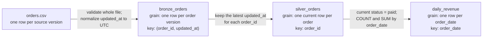

# Lab 01: Reliable order data

## Goal

Build a local batch pipeline that can be rerun safely. The CSV is a synthetic change log: each `(order_id, updated_at)` pair identifies one source version. Money is stored as integer cents to avoid floating-point rounding. `updated_at` must include a timezone and is normalized to UTC.

Run the commands in the root README. Inspect the database with any SQLite viewer or Python's `sqlite3` module. Predict the final paid revenue before running `report`.

## How data moves through the pipeline

Lab 01 is a small teaching pipeline, not a production warehouse design. It
uses three layers that are often called bronze, silver, and gold:

- **bronze** keeps every valid source version, as received
- **silver** keeps one current row per business entity
- **gold** keeps a small summary that a report reads



The same flow as plain text, for viewers that do not render Mermaid:

```text
orders.csv
   |  validate every row first, normalize updated_at to UTC
   v
bronze_orders   one row per (order_id, updated_at)   key: (order_id, updated_at)
   |  for each order_id, keep only the row with the latest updated_at
   v
silver_orders   one current row per order            key: order_id
   |  keep rows whose current status is paid, group by order_date
   v
daily_revenue   one row per order_date               key: order_date
```

| Table | Grain (one row per) | Primary key | Built from |
|---|---|---|---|
| `bronze_orders` | order version | `(order_id, updated_at)` | Every validated CSV row, with `updated_at` stored in UTC. A rerun of the same version is skipped; the same key with different values is rejected. |
| `silver_orders` | order | `order_id` | Rebuilt each run from bronze: the version with the latest `updated_at` for each `order_id`. |
| `daily_revenue` | order date | `order_date` | Rebuilt each run from silver: counts and sums only orders whose **current** status is `paid`. |

**Why bronze can hold several versions of one order but silver cannot:**
bronze's key is the pair `(order_id, updated_at)`, so a later update to the
same order has a different key and is stored alongside the earlier one. That
keeps the history. Silver's key is `order_id` alone, so there is room for only
one row per order, and the pipeline fills it with the latest version.

The sample file shows this. `o-101` arrives twice: `pending` at
`2026-01-02T11:00:00+00:00`, then `paid` at `2026-01-03T12:00:00+00:00`.
Bronze stores both rows (4 versions in total), silver keeps only the `paid`
row (3 current orders), and `daily_revenue` counts `o-101` as paid on its
`order_date`, 2026-01-02 (2 revenue days). Because gold reads the current
status from silver, a later `refunded` or `cancelled` version would remove
that order from the report on the next run.

## Exercises

1. Run the same file twice. Why are the counts and revenue unchanged?
2. Add a later `refunded` version for `o-100`. Predict what happens to the report.
3. Change a version's amount without changing its key. Why does the pipeline reject it?
4. Add an invalid row after a valid row. Verify that a failed run does not partially ingest the file.
5. Add a test for a timezone offset and a new test for a refund arriving late.

### Cross-midnight UTC exercise

Prerequisites: Python 3.11+, the repository root as your working directory, and
the first Lab 01 run in the root README. No extra packages or cloud account are
needed.
The goal is to distinguish an event's instant from its source business date,
then verify that retrying the same input does not duplicate revenue.

Create a separate file `midnight-orders.csv` with this synthetic input (keep the
existing `orders.csv` unchanged):

```csv
order_id,customer_id,order_date,amount_cents,status,updated_at
tz-1,c1,2026-01-01,100,paid,2026-01-01T00:30:00+05:30
```

Before running it, predict the UTC value of `updated_at`, the revenue date, and
the counts after a second identical run. Use a new `midnight-orders.db` file so
that earlier exercises do not contribute rows:

```bash
python3 -m launchpad.pipeline run --input midnight-orders.csv --db midnight-orders.db
python3 -m launchpad.pipeline report --db midnight-orders.db
python3 -m launchpad.pipeline run --input midnight-orders.csv --db midnight-orders.db
python3 -m launchpad.pipeline report --db midnight-orders.db
python3 -c "import sqlite3; c = sqlite3.connect('midnight-orders.db'); print(c.execute('SELECT order_date, updated_at FROM silver_orders').fetchall()); c.close()"
```

Both runs return `input_rows: 1`, `bronze_versions: 1`, `current_orders: 1`, and
`revenue_days: 1`. Both reports contain exactly:

```json
[
  {
    "order_date": "2026-01-01",
    "paid_orders": 1,
    "revenue_cents": 100
  }
]
```

The final query prints:

```text
[('2026-01-01', '2025-12-31T19:00:00+00:00')]
```

Subtracting the `+05:30` offset crosses midnight and the year boundary.
`updated_at` becomes an instant on the previous UTC day; `order_date` remains
the supplied business date, so the report still groups revenue under January 1.
The unchanged `(order_id, normalized updated_at)` key makes the repeated input
the same source version, rather than a second purchase.

For the opposite direction, use `2026-01-01T23:30:00-02:30` in a separate input
and a separate new database. It normalizes to `2026-01-02T02:00:00+00:00`, while
the same `order_date` still groups the revenue under January 1. Do not overwrite
the timestamp in the first file and treat that as a retry: it represents a new
event version.

Failure practice: remove the offset from the original timestamp. Validation
rejects the row with `updated_at must include a timezone` before writing.
These examples use explicit fixed offsets; they do not resolve named timezones
or daylight-saving ambiguity, and the pipeline does not derive `order_date`
from the UTC event date. After the exercise, remove only the input and database
files you created for it.

Automated check: `python3 -m unittest discover -s tests -v` includes both
cross-midnight directions, stored UTC values, preserved business dates, and
unchanged counts, stored rows, and revenue on retry.

Primary source: Python 3.11 [`datetime.astimezone`](https://docs.python.org/3.11/library/datetime.html#datetime.datetime.astimezone).
Reviewed: 2026-10-23 (UTC).

## Design choices and limits

The pipeline validates before writing and uses one database transaction for each run. It rebuilds its small derived tables each run; that is simple and deterministic but not efficient for a large dataset. A production-scale version would use bounded incremental windows or partitioned processing, explicit source contracts, observability, and a real storage/compute platform. The synthetic sample does not represent production diversity, privacy requirements, or performance.

Completion evidence: show the test output, explain how retries behave, and describe one case where `updated_at` alone would not provide a reliable ordering (for example, equal timestamps from different source events).
